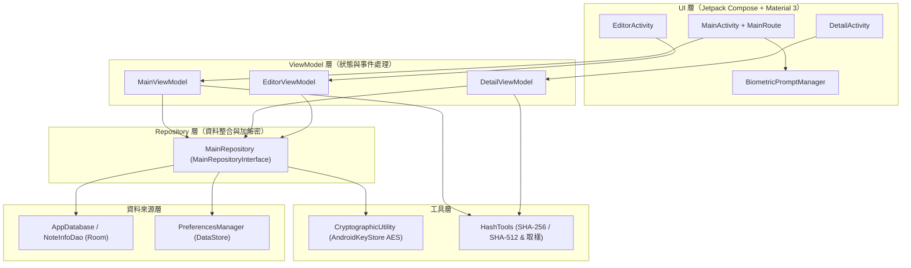

# 系統架構與模組設計

本專案採用單模組（`:app`）的 **MVVM（Model-View-ViewModel，模型－視圖－視圖模型）+ Repository（資料倉儲）** 分層架構，並透過 Hilt 進行 DI（Dependency Injection，依賴注入），以降低 UI、業務邏輯與資料來源之間的耦合度。

---

## 1. 整體分層架構

### 各層職責

* **UI 層（`ui/`、`manager/`）**：負責畫面繪製、接收使用者操作、啟動 Activity 跳轉、剪貼簿操作，以及透過 `BiometricPromptManager` 觸發系統生物辨識對話框。
* **ViewModel 層（`viewmodel/`）**：透過 Jetpack Compose 的 `mutableStateOf` 維護畫面狀態，呼叫 `MainRepository` 與 `HashTools` 完成資料讀寫、雜湊與取樣運算。
* **Repository 層（`repository/`）**：統一對外提供資料介面（`MainRepositoryInterface`），在寫入與讀取 Room 資料時自動進行敏感欄位加解密，並將 I/O 操作切換至背景執行緒。
* **資料來源層（`data/`）**：封裝 Room SQLite 資料庫與 DataStore Preferences（偏好設定資料存放區）。
* **工具層（`tools/`）**：提供無狀態或輕量的安全與演算法工具（加解密、雜湊與循環取樣、輸入正規表示式驗證）。

---

## 2. 套件目錄結構

所有主要原始碼位於 `app/src/main/java/com/itl/kglab/noteEncryptorManager/`：

| 目錄／檔案 | 職責說明 |
| :--- | :--- |
| `MyApplication.kt` | 掛載 `@HiltAndroidApp` 的應用程式進入點 |
| `data/db/` | Room `AppDatabase`、資料表實體 `NoteInfoColumn`、存取介面 `NoteInfoDao` |
| `data/db/updateInfo/` | Room 局部更新資料模型（`NoteInfoUpdate`、`InfoSettingUpdate`） |
| `data/pref/` | `PreferencesManager`（目前使用）與加密版 `SettingPreferencesSerializer` |
| `di/` | Hilt 模組：`DataSourceProviderModule`、`RepositoryProviderModule` |
| `manager/` | `BiometricPromptManager`（封裝系統生物辨識與裝置憑證驗證） |
| `repository/` | `MainRepositoryInterface` 與實作類別 `MainRepository` |
| `tools/` | `CryptographicUtility`、`HashTools`、`SettingInfo`、`SettingInputRegex` |
| `ui/screen/main/` | `MainActivity`、`ConverterScreen`、`NoteListScreen`、`SettingScreen`、底部導覽與路由 `route/` |
| `ui/screen/detail/` | `DetailActivity`（筆記檢視、轉換與取樣畫面） |
| `ui/screen/editor/` | `EditorActivity`（筆記新增／編輯畫面） |
| `ui/component/` | 共用 Compose 元件（`ContentTextCard`、`DescInputItem`、`OutlinedStyleButton`、`TableDivider`、`TitleFuncButtons`） |
| `ui/dialog/` | 共用對話框（`DeleteConfirmDialog`、`LoadingDialog`） |
| `ui/data/` | UI 事件資料模型（`NoteEventData`、`DeleteNoteDataEvent`、`PendingAuthAction`） |
| `ui/theme/` | Material 3 色彩、字型與主題設定 |
| `viewmodel/` | 對應三個主流程的 ViewModel 與 State 類別（`main/`、`detail/`、`editor/`） |

---

## 3. Hilt 依賴注入設計

專案使用兩個 Hilt 模組管理依賴生命週期：

1. **[DataSourceProviderModule.kt](../app/src/main/java/com/itl/kglab/noteEncryptorManager/di/DataSourceProviderModule.kt)**（`@InstallIn(SingletonComponent::class)`）
   * `PreferencesManager`（`@Singleton`）：綁定應用程式層級的 `Context.datastore`（名稱 `"settings"`）。
   * `AppDatabase`（`@Singleton`）：建立名為 `"NoteInfoData"` 的 Room 資料庫實例。
   * `NoteInfoDao`：由 `AppDatabase.noteInfoDao()` 提供。
   * `CoroutineDispatcher`：提供 `Dispatchers.IO` 供資料庫存取使用。
2. **[RepositoryProviderModule.kt](../app/src/main/java/com/itl/kglab/noteEncryptorManager/di/RepositoryProviderModule.kt)**（`@InstallIn(SingletonComponent::class)`）
   * 透過 `@Binds` + `@Singleton` 將 `MainRepository` 綁定至 `MainRepositoryInterface`，供所有 `@HiltViewModel`（`MainViewModel`、`DetailViewModel`、`EditorViewModel`）以介面注入，提升可測試性。

---

## 4. 非同步與執行緒分派

* **ViewModel 協程範圍**：所有資料讀取、寫入與雜湊運算皆在 `viewModelScope.launch` 中啟動，確保生命週期結束時自動取消。
* **I/O 執行緒隔離**：`MainRepository` 中涉及 Room 讀寫與欄位加解密的操作，均透過 `withContext(ioDispatcher)`（即 `Dispatchers.IO`）執行，避免阻塞主執行緒（UI Thread）。
* **事件流傳遞**：
  * DataStore 設定透過 Kotlin `Flow<SettingInfo>` 對外提供。
  * `BiometricPromptManager` 透過 `Channel<BioAuthResult>` 搭配 `receiveAsFlow()` 發送一次性驗證事件，由 `MainRoute` 內的 `LaunchedEffect` 收集（collect）處理，避免狀態重組時重複觸發。
