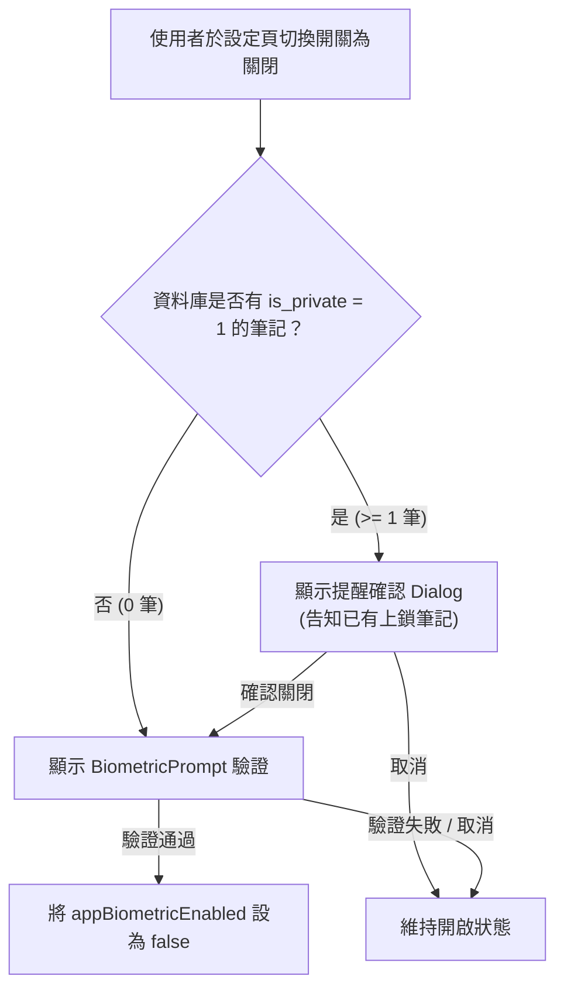
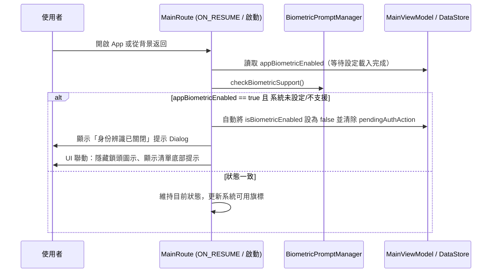

# 系統身份辨識提醒與狀態一致性功能規格

本文件定義 **NoteEncryptorManager（密語訊息筆記簿）** 的「系統身份辨識提醒功能」需求規格、狀態判斷邏輯、畫面互動流程與驗收條件，確保系統層級生物辨識設定、App 層級開關與單筆筆記密語標記之間維持一致且清楚的使用者體驗。

> 規格版本：v1.0（已定案）｜更新日期：2026-11-22

---

## 1. 核心狀態模型

系統中與身份辨識相關的狀態由以下三個維度組成：

| 狀態變數 | 來源 | 說明 |
| :--- | :--- | :--- |
| `systemBiometricReady` | `BiometricPromptManager.checkBiometricSupport() == AuthenticationSuccess` | 裝置支援生物辨識／裝置憑證且使用者已於系統完成設定 |
| `appBiometricEnabled` | DataStore（`setting_biometric_enabled`） | 使用者於 App「設定」頁開啟的身份辨識開關 |
| `note.isPrivate` | Room（`noteInfoTable.is_private`） | 單筆筆記是否勾選啟用身份辨識保護 |

### 衍生有效狀態與顯示真值表

定義 **`isBiometricEffective = appBiometricEnabled && systemBiometricReady`**（身份辨識實際生效中）：

| `systemBiometricReady` | `appBiometricEnabled` | `note.isPrivate` | 顯示鎖定圖示（需求 4） | 清單下方未開啟提示（需求 3） | 編輯頁開關狀態（需求 1） | 啟動自動關閉提醒（需求 5） |
| :---: | :---: | :---: | :---: | :---: | :---: | :---: |
| `true` | `true` | `true` | **顯示** | 不顯示 | 可正常切換 | 不觸發 |
| `true` | `true` | `false` | 不顯示 | 不顯示 | 可正常切換 | 不觸發 |
| `true` | `false` | `true` / `false` | **不顯示** | **顯示** | **反灰禁用＋點擊提醒** | 不觸發 |
| `false` | `true`（系統後來取消） | `true` / `false` | **不顯示** | **顯示**（自動關閉後） | **反灰禁用＋點擊提醒** | **觸發 Dialog 並設為 `false`** |
| `false` | `false` | `true` / `false` | **不顯示** | **顯示** | **反灰禁用＋點擊提醒** | 不觸發 |

> **資料保留原則**：當 `appBiometricEnabled` 關閉（無論使用者主動關閉或系統移除後自動關閉）時，資料庫中各筆筆記既有的 `is_private` 欄位值**預設保留不清除**，僅在顯示與存取層面不套用鎖定；待未來重新啟用身份辨識時，原有密語筆記可自動恢復保護。

---

## 2. 功能需求規格明細

### 需求 1：新增／編輯筆記頁的身份辨識開關防呆與提醒

* **適用畫面**：[EditorActivity.kt](../app/src/main/java/com/itl/kglab/noteEncryptorManager/ui/screen/editor/EditorActivity.kt)（新增與編輯模式皆適用）
* **元件調整**：將現行「是否啟用生物驗證」控制項調整為 **`Switch`**（取代原 `Checkbox`）。
* **行為規則**：
  1. 進入畫面時讀取目前 `appBiometricEnabled`（與 `systemBiometricReady`）狀態。
  2. **當 `isBiometricEffective == true`**：`Switch` 為正常啟用狀態，使用者可自由切換 `isPrivate`。
  3. **當 `isBiometricEffective == false`（App 尚未開啟或系統未設定）**：
     * `Switch` 呈現**反灰（Disabled）且無法改變狀態**。
     * 點擊該開關或其整列容器時，顯示 **`Toast`** 提示：「**請先至設定選單開啟身份辨識功能**」。
     * **編輯舊筆記邊界情境**：若該筆記原本 `isPrivate == true`，但目前 App 已關閉身份辨識，編輯其他欄位並儲存時應維持其原 `isPrivate` 值不被意外改寫（UI 上反灰顯示）。

---

### 需求 2：設定頁關閉身份辨識時的上鎖筆記防呆確認

* **適用畫面**：[SettingScreen.kt](../app/src/main/java/com/itl/kglab/noteEncryptorManager/ui/screen/main/SettingScreen.kt)、[MainRoute.kt](../app/src/main/java/com/itl/kglab/noteEncryptorManager/ui/screen/main/route/MainRoute.kt)
* **觸發條件**：使用者在設定頁將「啟用生物辨識驗證」開關從 **開啟 → 關閉**（`targetState == false`）。
* **行為流程**：
  1. 查詢資料庫中是否存在 `is_private = 1` 的筆記（建議由 `NoteInfoDao` 提供計數查詢 `countPrivateNotes()`）。
  2. **若存在上鎖資料（`privateCount > 0`）**：
     * 先彈出確認 `AlertDialog`：
       * 建議標題：`確定要關閉身份辨識？`
       * 建議內文：`目前有 %1$d 筆筆記已啟用身份辨識保護，關閉後將不需驗證即可查看與操作，確定要關閉嗎？`
       * 按鈕：「確認」／「取消」
     * 使用者點擊「取消」→ 關閉對話框，開關維持開啟。
     * 使用者點擊「確認」→ 接續執行系統 `BiometricPrompt` 身份驗證；驗證通過後將 `appBiometricEnabled` 設為 `false`，**並保留資料庫中既有筆記的 `is_private` 標記**（未來重新開啟身份辨識時自動恢復上鎖保護）。
  3. **若無任何上鎖資料（`privateCount == 0`）**：不顯示額外警告對話框，直接依現行流程執行 `BiometricPrompt` 驗證後關閉。



---

### 需求 3：筆記清單下方顯示未開啟身份辨識提示

* **適用畫面**：[NoteListScreen.kt](../app/src/main/java/com/itl/kglab/noteEncryptorManager/ui/screen/main/NoteListScreen.kt)
* **顯示條件**：當 `isBiometricEffective == false`（App 尚未開啟身份辨識功能，或系統未設定）。
* **畫面規格**：
  * 於筆記清單畫面底部（位於 `MainBottomNavigationBar` 上方、固定於清單區域底部）顯示提示訊息：**「尚未設定或開啟身份辨識」**。
  * **點擊互動**：點擊該提示列可直接切換底部導覽至「**設定**（`MainBottomNavigationItem.Setting`）」分頁，方便使用者立即開啟。
  * 無論筆記清單為空或已有多筆資料皆應清楚可見，且不可遮擋 `LazyColumn` 最下方卡片的閱讀與點擊。
  * 視覺上使用柔和提示色（例如 `MaterialTheme.colorScheme.surfaceVariant` 底色搭配 `onSurfaceVariant` 文字與資訊圖示），兼顧淺色與深色主題。
  * 當 `isBiometricEffective == true` 時隱藏該提示條。

---

### 需求 4：鎖定圖示顯示條件統一

* **適用畫面**：
  1. [NoteListScreen.kt](../app/src/main/java/com/itl/kglab/noteEncryptorManager/ui/screen/main/NoteListScreen.kt)（`NoteListItem` → `NoteItemTitle`）
  2. [DetailActivity.kt](../app/src/main/java/com/itl/kglab/noteEncryptorManager/ui/screen/detail/DetailActivity.kt)（`InformationTitleCard`）
* **顯示規則**：
  * 鎖定圖示（`Icons.Outlined.Lock`）僅在以下條件**全部成立**時顯示：
    ```kotlin
    val showLockIcon = note.isPrivate && appBiometricEnabled && systemBiometricReady
    ```
  * 若單筆筆記 `isPrivate == true`，但 App 未開啟身份辨識 **或** 系統尚未設定／不支援身份辨識，鎖定圖示**不顯示**。

---

### 需求 5：系統取消身份辨識時的啟動偵測與自動關閉

* **適用畫面**：[MainActivity.kt](../app/src/main/java/com/itl/kglab/noteEncryptorManager/ui/screen/main/MainActivity.kt) / [MainRoute.kt](../app/src/main/java/com/itl/kglab/noteEncryptorManager/ui/screen/main/route/MainRoute.kt)
* **觸發時機**：
  1. App 啟動並完成 DataStore 設定載入後。
  2. App 從背景返回前台（`Lifecycle.Event.ON_RESUME`），涵蓋使用者於 App 開啟狀態下切換至系統設定移除指紋／螢幕鎖定後再切回 App 的情境。
* **偵測條件**：
  * `appBiometricEnabled == true` **且** `bioAuthManager.checkBiometricSupport() != BioAuthResult.AuthenticationSuccess`（包含 `AuthenticationNotSet`、`HardwareUnavailable`、`FeatureUnavailable`）。
* **處理動作**：
  1. 立即將 DataStore 的 `setting_biometric_enabled` 更新為 `false`，並清空 `MainViewModel.pendingAuthAction`。
  2. 顯示提示 `AlertDialog`：
     * 建議標題：`身份辨識已關閉`
     * 建議內文：`系統已取消身份辨識設定，應用程式的身份辨識功能已自動關閉。若需重新啟用，請先於系統設定完成後再開啟。`
     * 按鈕：
       * **確認按鈕**：「前往系統設定」（API 30+ 導向 `Settings.ACTION_BIOMETRIC_ENROLL`；API 29 導向 `Settings.ACTION_SECURITY_SETTINGS`）
       * **取消／關閉按鈕**：「確認」（關閉對話框）
  3. 狀態更新後自動聯動：清單下方顯示「尚未設定或開啟身份辨識」（需求 3）、所有筆記隱藏鎖定圖示（需求 4）、編輯頁開關轉為反灰不可用（需求 1）。
  4. **防重複彈窗**：因 `appBiometricEnabled` 已被寫回 `false`，後續再次 `ON_RESUME` 不會重複跳出同一提示。



---

## 3. 預計影響的模組與檔案

| 層級 | 檔案 | 預計異動重點 |
| :--- | :--- | :--- |
| Data / DAO | [NoteInfoDao.kt](../app/src/main/java/com/itl/kglab/noteEncryptorManager/data/db/NoteInfoDao.kt) | 新增 `SELECT COUNT(*) FROM noteInfoTable WHERE is_private = 1` 查詢 |
| Repository | [MainRepositoryInterface.kt](../app/src/main/java/com/itl/kglab/noteEncryptorManager/repository/MainRepositoryInterface.kt)、[MainRepository.kt](../app/src/main/java/com/itl/kglab/noteEncryptorManager/repository/MainRepository.kt) | 暴露 `getPrivateNoteCount(): Int` |
| ViewModel | [MainViewModel.kt](../app/src/main/java/com/itl/kglab/noteEncryptorManager/viewmodel/main/MainViewModel.kt)、[ScreenState.kt](../app/src/main/java/com/itl/kglab/noteEncryptorManager/viewmodel/main/ScreenState.kt) | 追蹤設定是否已載入、保存 `isSystemBiometricReady` 與 `privateNoteCount`、提供自動關閉身份辨識方法 |
| ViewModel | [EditorViewModel.kt](../app/src/main/java/com/itl/kglab/noteEncryptorManager/viewmodel/editor/EditorViewModel.kt)、[DetailViewModel.kt](../app/src/main/java/com/itl/kglab/noteEncryptorManager/viewmodel/detail/DetailViewModel.kt) | 讀取 `settingInfo.isBiometricEnabled`，供 UI 判斷開關啟用與鎖頭圖示顯示 |
| UI | [EditorActivity.kt](../app/src/main/java/com/itl/kglab/noteEncryptorManager/ui/screen/editor/EditorActivity.kt) | `Checkbox` 改為 `Switch`，未啟用時反灰並攔截點擊顯示提醒 |
| UI | [NoteListScreen.kt](../app/src/main/java/com/itl/kglab/noteEncryptorManager/ui/screen/main/NoteListScreen.kt) | 傳入 `isBiometricEffective`，控制鎖頭圖示顯示與底部「尚未設定或開啟身份辨識」提示條 |
| UI | [DetailActivity.kt](../app/src/main/java/com/itl/kglab/noteEncryptorManager/ui/screen/detail/DetailActivity.kt) | 結合 `BiometricPromptManager`（或 `BiometricManager`）與 `isBiometricEnabled` 控制鎖頭圖示顯示 |
| UI | [MainRoute.kt](../app/src/main/java/com/itl/kglab/noteEncryptorManager/ui/screen/main/route/MainRoute.kt) | 實作啟動／回前景系統偵測自動關閉 Dialog，以及設定頁取消時的「已有上鎖資料」確認 Dialog |
| 資源 | [strings.xml](../app/src/main/res/values/strings.xml) | 集中新增所有提示文字、對話框標題與按鈕文案 |

---

## 4. 已確認 UX 細節決議

1. **需求 1（編輯頁反灰開關點擊提醒形式）**：使用 `Toast` 提示使用者至設定選單開啟身份辨識。
2. **需求 2（關閉 App 身份辨識後的既有筆記狀態）**：保留資料庫原 `is_private` 標記，待重新開啟身份辨識後自動恢復上鎖保護與鎖頭顯示。
3. **需求 3（筆記清單底部提示列互動）**：點擊該提示列直接切換至「設定」分頁。
4. **需求 5（系統取消身份辨識提示 Dialog 按鈕）**：同時提供「前往系統設定」與「確認」按鈕。

---

## 5. 驗收測試情境清單（Acceptance Criteria）

* **AC-1**：App 未開啟身份辨識時進入新增／編輯筆記頁，身份辨識 `Switch` 呈現反灰不可切換，點擊後顯示 `Toast` 提醒。
* **AC-2**：App 已開啟身份辨識且資料庫存在至少 1 筆 `isPrivate = true` 筆記時，在設定頁點選關閉開關會先跳出確認 Dialog；點「取消」維持開啟，點「確認」後進行驗證並成功關閉，且資料庫既有 `is_private` 標記仍保留（重開後自動恢復上鎖）。
* **AC-3**：App 已開啟身份辨識且資料庫無任何 `isPrivate = true` 筆記時，在設定頁關閉開關不顯示額外警告 Dialog，直接走驗證關閉。
* **AC-4**：App 未開啟身份辨識時，筆記清單（無論空清單或有資料）底部皆顯示「尚未設定或開啟身份辨識」提示，點擊後直接切換至「設定」分頁；開啟後該提示自動消失。
* **AC-5**：資料庫存在 `isPrivate = true` 筆記，但 App 或系統未開啟身份辨識時，筆記清單與詳細頁均不顯示鎖定圖示；兩者皆開啟時才顯示鎖定圖示。
* **AC-6**：原先系統與 App 皆開啟身份辨識，於系統設定移除螢幕鎖定／生物辨識後重新開啟或切回 App，立即跳出「身份辨識已關閉」提醒 Dialog（含「前往系統設定」與「確認」按鈕），並自動將 App 設定改為關閉（再次重開不重複彈窗）。
