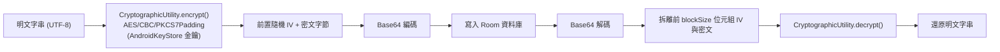

# 資料結構與安全設計

由於本專案用於管理使用者的私密筆記與雜湊資訊，資料儲存、加解密、雜湊取樣與生物辨識皆為系統的核心安全邊界。

---

## 1. Room 本地資料庫設計

* **資料庫類別**：[AppDatabase.kt](../app/src/main/java/com/itl/kglab/noteEncryptorManager/data/db/AppDatabase.kt)
* **資料庫名稱**：`NoteInfoData`（定義於 `DataSourceProviderModule`）
* **目前版本**：`version = 1`（`exportSchema = true`，匯出檔位於 [1.json](../app/schemas/com.itl.kglab.noteEncryptorManager.data.db.AppDatabase/1.json)）

### 1.1 資料表 `noteInfoTable`（`NoteInfoColumn`）

| 欄位名稱（SQL） | Kotlin 屬性 | 型別 | 預設值 | 資料庫加密儲存 | 說明 |
| :--- | :--- | :--- | :--- | :---: | :--- |
| `id` | `id` | `INTEGER`（PK, AutoIncrement） | `-1`（新增時傳 `0`） | 否 | 筆記主鍵 |
| `title` | `title` | `TEXT` | `""` | 否 | 筆記標題 |
| `time_desc` | `timeDesc` | `TEXT` | `"Undefine"` | 否 | 建立／紀錄時間字串（`yyyy-MM-dd HH:mm`） |
| `note` | `note` | `TEXT` | `""` | **是** | 備註內容 |
| `is_private` | `isPrivate` | `INTEGER`（Boolean） | `false` | 否 | 是否受生物辨識保護 |
| `input_text` | `inputText` | `TEXT` | `""` | **是** | 轉換器輸入原文 |
| `output_text` | `outputText` | `TEXT` | `""` | **是** | 雜湊轉換結果 |
| `sampled_message` | `sampledMessage` | `TEXT` | `""` | **是** | 取樣後的結果字串 |
| `sample_size` | `sampleSize` | `INTEGER` | `0` | 否 | 取樣長度 |
| `sample_index` | `sampleIndex` | `INTEGER` | `0` | 否 | 取樣起始索引 |

### 1.2 局部更新模型（Partial Update Entities）

為避免不同畫面覆寫到非負責欄位，`NoteInfoDao` 透過兩個局部更新類別更新特定欄位：

* **[NoteInfoUpdate.kt](../app/src/main/java/com/itl/kglab/noteEncryptorManager/data/db/updateInfo/NoteInfoUpdate.kt)**（由 `EditorViewModel` 使用）：更新 `title`、`time_desc`、`note`（自動加密）、`is_private`。
* **[InfoSettingUpdate.kt](../app/src/main/java/com/itl/kglab/noteEncryptorManager/data/db/updateInfo/InfoSettingUpdate.kt)**（由 `DetailViewModel` 使用）：更新 `input_text`、`output_text`、`sampled_message`（三者皆自動加密）、`sample_size`、`sample_index`。

---

## 2. DataStore 偏好設定設計

* **實作檔案**：[PreferencesManager.kt](../app/src/main/java/com/itl/kglab/noteEncryptorManager/data/pref/PreferencesManager.kt)
* **存放名稱**：`preferencesDataStore(name = "settings")`

| Preference Key（設定鍵值） | 型別 | 預設值 | 狀態／用途 |
| :--- | :--- | :--- | :--- |
| `setting_algorithm` | `String` | `""`（空值時 `HashTools` 預設使用 `SHA-256`） | 使用中的雜湊演算法名稱 |
| `setting_biometric_enabled` | `Boolean` | `false` | 全域生物辨識保護開關 |
| `setting_prefix`、`setting_suffix`、`setting_sample_index`、`setting_sample_size` | `String` / `Int` | — | 舊版本遺留鍵值，可透過 `clearLastVersionKeys()` 清理 |

> 專案內另保留 [SettingPreferencesSerializer.kt](../app/src/main/java/com/itl/kglab/noteEncryptorManager/data/pref/SettingPreferencesSerializer.kt)，示範結合 `CryptographicUtility` 與 `kotlinx.serialization` 的加密序列化器實作（目前執行期由 `PreferencesManager` 負責讀寫）。

---

## 3. 欄位加解密機制

所有資料庫敏感欄位的加解密統一由 [MainRepository.kt](../app/src/main/java/com/itl/kglab/noteEncryptorManager/repository/MainRepository.kt) 呼叫 [CryptographicUtility.kt](../app/src/main/java/com/itl/kglab/noteEncryptorManager/tools/CryptographicUtility.kt) 透明執行：

### 加密參數規格
* **金鑰存放區**：`AndroidKeyStore`（金鑰別名 `KEY_ALIAS = "crypt_key"`，不存在時自動透過 `KeyGenerator` 產生）。
* **演算法與模式**：`AES/CBC/PKCS7Padding`。
* **隨機 IV（Initialization Vector，初始向量）**：設定 `setRandomizedEncryptionRequired(true)`，每次加密皆產生新的隨機 IV 並附加於密文位元組陣列開頭；解密時依 `cipher.blockSize` 切出 IV 與密文還原。
* **資料庫序列化**：以 Kotlin 標準庫 `kotlin.io.encoding.Base64` 轉為字串存入 Room `TEXT` 欄位。

> **維護注意事項**：切勿任意變更 `KEY_ALIAS`、`TRANSFORMATION` 或 IV 拼接格式，否則既有使用者的已加密資料庫欄位將無法解密。

---

## 4. 雜湊與循環取樣演算法

實作位於 [HashTools.kt](../app/src/main/java/com/itl/kglab/noteEncryptorManager/tools/HashTools.kt) 與 [SettingInputRegex.kt](../app/src/main/java/com/itl/kglab/noteEncryptorManager/tools/SettingInputRegex.kt)：

### 4.1 雜湊轉換（`hashMessage`）
* 支援演算法（`HashAlgorithmType`）：
  * `SHA-256`（預設，當設定值為空白時回退至此演算法）
  * `SHA-512`
* 流程：透過 `java.security.MessageDigest` 計算輸入字串位元組摘要並重設 `MessageDigest`，再使用 `android.util.Base64.encodeToString(hashArray, Base64.URL_SAFE)` 輸出 URL-Safe Base64 字串。

### 4.2 循環取樣（`sampleMessage`）
* **輸入檢核（`SettingInputRegex`）**：
  * 即時輸入限制：`^[0-9]{0,2}$`（最多兩位數字）。
  * 送出檢核：`sampleIndexCheckRegex = ^[1-9][0-9]?$`（未符合時預設為 `DEFAULT_INDEX = 0`）；`sampleSizeCheckRegex = [1-9][0-9]?$`（未符合時預設為 `DEFAULT_SIZE = 8`）。
* **取樣規則**：
  * 若 `size == 0`，預設取樣整個字串長度。
  * 起始索引會先對訊息長度取餘數（`index % message.length`）。
  * 依序逐字取值；若超過字串結尾則**循環折返**回索引 `0`，同時略過換行符號（ASCII `10`）。

---

## 5. 生物辨識驗證實作

實作位於 [BiometricPromptManager.kt](../app/src/main/java/com/itl/kglab/noteEncryptorManager/manager/BiometricPromptManager.kt)：

* **允許的驗證器（Authenticators）**：
  * **Android 11+（API 30 以上）**：`BIOMETRIC_STRONG or DEVICE_CREDENTIAL`（允許強生物辨識或裝置 PIN／圖形／密碼，依 Android 規範不額外設定負面按鈕文字）。
  * **Android 10（API 29）**：`BIOMETRIC_STRONG`，並設定負面按鈕文字為 `"取消"`。
* **結果狀態模型（`BioAuthResult`）**：
  * `Init`（重設狀態用）
  * `HardwareUnavailable`、`FeatureUnavailable`、`AuthenticationNotSet`
  * `AuthenticationSuccess`、`AuthenticationFailed`、`AuthenticationError(errorMessage)`

---

## 6. 應用程式層級備份與安全防護

在 [AndroidManifest.xml](../app/src/main/AndroidManifest.xml) 中已明確設定：

* `android:allowBackup="false"`：停用 Android Auto Backup，避免本地端加密資料庫或偏好設定隨雲端備份外流。
* `DetailActivity` 與 `EditorActivity` 皆設為 `android:exported="false"`，僅允許應用程式內部啟動，防止外部應用程式透過 Intent 繞過主畫面的生物辨識檢查直接開啟筆記內容。
