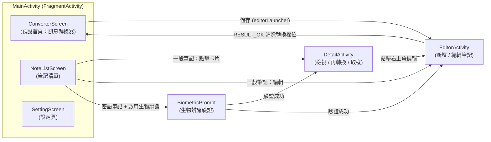

# 核心功能與畫面流程

本應用程式以三個 Activity（活動元件）為核心：`MainActivity`（主畫面與底部導覽）、`DetailActivity`（筆記詳細與取樣頁）與 `EditorActivity`（筆記新增／編輯頁），並搭配 Type-safe（型別安全）Navigation Compose 進行主分頁切換。

---

## 1. 畫面導覽總覽

> `MainActivity` 繼承 `FragmentActivity`（而非一般 `ComponentActivity`），以符合 AndroidX `BiometricPrompt` 所需的宿主型別要求。

---

## 2. 主畫面與底部導覽（`MainActivity` / `MainRoute`）

底部導覽項目定義於 [MainBottomNavigationItem.kt](../app/src/main/java/com/itl/kglab/noteEncryptorManager/ui/screen/main/route/MainBottomNavigationItem.kt)，以 `@Serializable` 搭配 Navigation Compose 實作型別安全路由：

| 分頁項目 | 路由名稱 | 畫面元件 | 說明 |
| :--- | :--- | :--- | :--- |
| `Converter`（預設首頁） | `"Converter"` | `ConverterScreen` | 輸入原文並轉換為雜湊結果 |
| `NoteList` | `"List"` | `NoteListScreen` | 檢視、編輯與刪除已儲存筆記 |
| `Setting` | `"Setting"` | `SettingScreen` | 設定雜湊演算法與生物辨識開關 |

### 2.1 訊息轉換器（`ConverterScreen`）
* **狀態來源**：`MainViewModel.inputState`、`MainViewModel.resultState`。
* **主要操作**：
  * **轉換**：收合鍵盤，使用目前設定的 `HashTools`（`SHA-256` 或 `SHA-512`）計算雜湊值並更新結果卡片。
  * **複製／長按結果卡**：點擊「複製」按鈕或長按結果卡片（`ContentTextCard`）時，若雜湊結果非空白，將結果寫入系統剪貼簿（`LocalClipboard`）並提示已複製。
  * **儲存**：結果非空白時才觸發（空白不動作），將原文（`ARG_INPUT`）與雜湊結果（`ARG_OUTPUT`）透過 `editorLauncher` 傳入 `EditorActivity`；當編輯頁儲存完成並回傳 `Activity.RESULT_OK` 時，自動呼叫 `MainViewModel.clear()` 清空輸入與結果欄位。
  * **清除**：清空目前輸入與轉換結果。
  * **捲動適配**：外層支援垂直捲動，確保在橫向或分割畫面下仍可操作底部按鈕。

### 2.2 筆記清單（`NoteListScreen`）
* **狀態來源**：`MainViewModel.state.noteInfoList`（`List<NoteInfoListInfoData>`），且 `MainRoute` 會於 `Lifecycle.Event.ON_RESUME` 自動重新查詢最新清單。
* **顯示內容**：
  * 清單為空時顯示空狀態提示文字。
  * 每筆卡片（`NoteListItem`）顯示：鎖頭圖示（僅在 `isPrivate == true` 且 App 與系統身份辨識皆啟用時顯示）、單行標題（過長省略）、建立／更新時間、最多兩行的備註預覽，以及右上角選單（編輯／刪除）。
  * 當 App 或系統尚未啟用身份辨識時，畫面底部固定顯示「尚未設定或開啟身份辨識」提示條，點擊可直接切換至「設定」分頁。
* **刪除保護**：點擊「刪除」後會先跳出 `DeleteConfirmDialog` 二次確認；若該筆筆記啟用密語保護且全域生物辨識已開啟，確認後仍需通過生物辨識才會真正刪除。

### 2.3 設定頁（`SettingScreen`）
* **雜湊演算法選擇**：透過 `ExposedDropdownMenuBox` 選擇 `SHA-256` 或 `SHA-512`，點擊「儲存」後寫入 DataStore 並重建 `HashTools` 實例；點擊「重設」則還原為已儲存的設定值。演算法變更僅影響後續新執行的雜湊轉換，不會自動重算已儲存筆記的既有密文。
* **生物辨識驗證開關**：
  * 切換 `Switch` 時不會直接變更狀態，而是先呼叫 `bioAuthManager.checkBiometricSupport()` 檢查硬體與設定狀態：
    * 硬體不支援或無法使用：顯示 `Toast` 提示。
    * 嘗試啟用但裝置尚未登錄生物辨識：顯示 `AlertDialog` 引導前往系統設定（API 30+ 開啟 `ACTION_BIOMETRIC_ENROLL`；API 29 開啟 `ACTION_SECURITY_SETTINGS`）。
    * 裝置支援且已設定：紀錄 `PendingAuthAction.ToggleBiometric(targetState)` 並觸發身份驗證，通過後才儲存新狀態。

---

## 3. 生物辨識待處理動作機制（`PendingAuthAction`）

為了在非同步生物辨識成功後精準執行原本的操作，[PendingAuthAction.kt](../app/src/main/java/com/itl/kglab/noteEncryptorManager/ui/data/PendingAuthAction.kt) 定義了四種受保護意圖：

| 動作型別 | 觸發條件 | 驗證成功後行為 |
| :--- | :--- | :--- |
| `OpenDetail(id)` | 筆記 `isPrivate == true` 且開啟生物辨識，點擊卡片 | 開啟 `DetailActivity` 並帶入 `ARG_ID` |
| `EditNote(id)` | 筆記 `isPrivate == true` 且開啟生物辨識，點擊「編輯」 | 開啟 `EditorActivity`（編輯模式） |
| `DeleteNote(id)` | 筆記 `isPrivate == true` 且開啟生物辨識，確認刪除 | 呼叫 `MainViewModel.deleteNoteInfoById(id)` |
| `ToggleBiometric(targetState)` | 在設定頁切換生物辨識開關 | 更新並儲存 DataStore 生物辨識設定 |

`MainRoute` 透過 `LaunchedEffect(bioAuthManager)` 持續收集 `bioAuthManager.promptResult`，於收到 `BioAuthResult.AuthenticationSuccess` 時執行對應 `pendingAuthAction` 並清空該暫存狀態。

---

## 4. 筆記詳細與取樣頁（`DetailActivity`）

* **傳入參數**：`DetailActivity.ARG_ID`（`Long`，筆記主鍵）。
* **資料載入與刷新**：初次進入畫面時載入完整解密資料；當點擊右上角編輯並從 `EditorActivity` 返回 `RESULT_OK` 時，僅刷新筆記基本資訊（標題、時間、備註、`isPrivate`），避免在切回前台或旋轉螢幕時覆蓋使用者尚未送出的轉換／取樣輸入。
* **畫面區塊**：
  1. **標題列（`TitleFuncButtons`）**：左側返回、右側編輯（開啟 `EditorActivity` 編輯標題與備註）。
  2. **筆記基本資訊卡（`NoteInfoDetailTable`）**：顯示鎖頭圖示（若為密語）、標題、時間與備註內容（長按備註可複製）。
  3. **轉換器區塊（`SimpleTable` 上半部）**：可檢視或修改原文（`input`，一般文字鍵盤）並重新轉換為雜湊結果（`output`，長按可複製），運算完成後會自動呼叫 `updateNoteSampleSetting()` 回存資料庫。
  4. **取樣設定區塊（`SimpleTable` 下半部）**：輸入「取樣起始（`sampleIndex`，0～99 整數）」與「取樣長度（`sampleSize`，1～99 整數，空白或 0 預設為 8）」，點擊「取樣」產生 `sampledMessage`（長按可複製）並自動寫入資料庫。
  5. **載入指示**：進行轉換或取樣期間，依 `DetailViewModel.uiState.isLoading` 顯示 `LoadingDialog`。

---

## 5. 筆記新增／編輯頁（`EditorActivity`）

* **兩種進入模式**（依據 Intent `ARG_ID` 判斷，且僅於首次初始化載入，旋轉螢幕時保留使用者編輯中狀態）：
  * **新增模式**（`ARG_ID` 未傳入或為 `ARG_DEFAULT_ID = -1L`）：讀取 `ARG_INPUT`、`ARG_OUTPUT`，呼叫 `EditorViewModel.setNewInfo()`（將內部 `id` 設為 `0L`）。
  * **編輯模式**（傳入既有 `ARG_ID`）：呼叫 `EditorViewModel.findNoteInfo(id)` 自資料庫讀取解密後的完整筆記（包含原始建立時間 `timeDesc`）。
* **可編輯欄位**：標題（單行）、`是否啟用生物驗證`（`Switch`，對應 `isPrivate`；若 App 或系統尚未開啟身份辨識則反灰禁用，點擊以 `Toast` 提醒至設定選單開啟）、備註；下方以唯讀 `ContentTextCard` 顯示關聯的原文與雜湊密文（皆支援長按複製）。
* **儲存行為**：
  * `id == 0L`：建立新紀錄（時間格式為 `yyyy-MM-dd HH:mm`，語系 `Locale.TAIWAN`），寫入 Room 時自動加密敏感欄位。
  * `id != 0L`：以 `NoteInfoUpdate` 執行局部更新（更新標題、備註與 `isPrivate`，保留原始建立時間 `timeDesc` 及原本的原文、密文與取樣設定）。
  * 須待資料庫非同步寫入完成後，再由事件通知 UI 呼叫 `setResult(RESULT_OK)` 並結束畫面，避免寫入中斷或前頁讀到舊資料。
